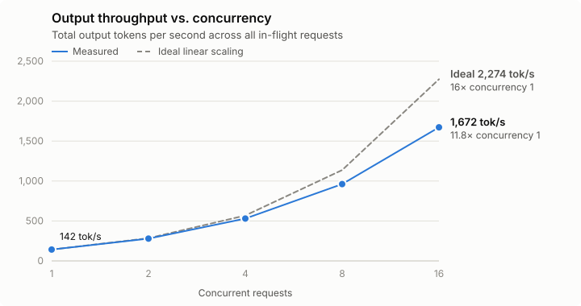
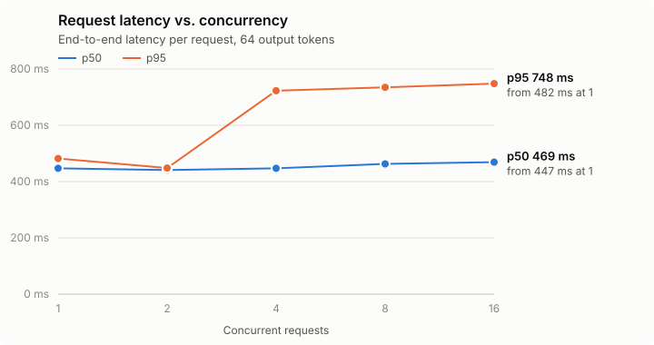

# Day 02: vLLM Serving Benchmark

## 1. Setup

### Hardware

| Property | Value |
|---|---|
| GPU | NVIDIA GeForce RTX 4050 Laptop GPU |
| Total VRAM | 6 GiB (6,141 MiB) |
| VRAM free at server startup | 4.91 GiB (Windows uses the rest) |
| VRAM given to vLLM | 4.2 GiB (`--gpu-memory-utilization 0.7`) |
| KV cache | 1 GiB (`--kv-cache-memory-bytes`) |
| NVIDIA driver | 610.78 |
| OS | Windows 11, server in WSL2 (Ubuntu 24.04) |

### Software

| Property | Value |
|---|---|
| vLLM | 0.33.0 (V1 engine) |
| PyTorch | 2.14.0+cu130 |
| CUDA runtime | 13.0 |
| Model | `Qwen/Qwen2.5-0.5B-Instruct` (bfloat16) |

### Launch command

```bash
VLLM_USE_FLASHINFER_SAMPLER=0 vllm serve Qwen/Qwen2.5-0.5B-Instruct \
  --api-key local-test \
  --max-model-len 4096 \
  --gpu-memory-utilization 0.7 \
  --kv-cache-memory-bytes 1073741824
```

| Argument | Value | Why |
|---|---|---|
| `--max-num-seqs` | **256** (vLLM default, not set) | Maximum requests vLLM batches together in one step. The highest concurrency tested (16) is far below this, so the scheduler never had to queue requests. |
| `--max-num-batched-tokens` | 2,048 (vLLM default, not set) | Maximum tokens processed per step. vLLM picks 2,048 for GPUs with under 70 GiB of memory. |
| `--max-model-len` | 4,096 | Limits context length, so less memory is reserved per request. |
| `--gpu-memory-utilization` | 0.7 | The default (0.92) asks for more VRAM than is free on a laptop GPU that also drives the display. |
| `--kv-cache-memory-bytes` | 1 GiB | Without it, vLLM tried to allocate a single 3.11 GiB KV cache block and ran out of memory. |
| `VLLM_USE_FLASHINFER_SAMPLER=0` | | FlashInfer's sampling kernels need either a 1.7 GB download or the CUDA compiler, so PyTorch's sampler is used instead. |
| Prefix caching | On (default) | Every request uses the same prompt, so prefill is reused after the first request. |

### Workload

| Property | Value |
|---|---|
| Client | `benchmark.py` (OpenAI-compatible API, `AsyncOpenAI`) |
| Prompt | "Explain continuous batching in LLM serving." |
| Output tokens per request | 64 (`ignore_eos`, so every request generates exactly 64) |
| Requests per concurrency level | 32, plus 1 warmup request |
| Concurrency levels | 1, 2, 4, 8, 16 |
| Sampling | Greedy (`temperature=0`) |

## 2. Performance summary

| Metric | Value |
|---|---|
| Peak throughput | **1,671.89 output tokens/s** (concurrency 16) |
| Throughput scaling, concurrency 1 → 16 | **11.8×** (73% of ideal linear scaling) |
| Mean latency increase, concurrency 1 → 16 | **+19.6%** (0.450 s → 0.538 s) |
| p50 latency increase, concurrency 1 → 16 | +4.9% (447 ms → 469 ms) |

## 3. Throughput scaling

| Concurrency | Requests/s | Output tokens/s | Scaling vs 1 |
|---:|---:|---:|---:|
| 1 | 2.22 | 142.11 | 1.00× |
| 2 | 4.37 | 279.65 | 1.97× |
| 4 | 8.29 | 530.59 | 3.73× |
| 8 | 15.03 | 961.74 | 6.77× |
| 16 | 26.12 | 1,671.89 | 11.76× |



Throughput scales almost linearly up to concurrency 4 (3.73× of an ideal 4×), then starts to fall below the ideal line. At 16 concurrent requests it reaches 11.76× of an ideal 16×. Continuous batching lets vLLM decode all in-flight requests in one forward pass. For a 0.5B model, each decode step is limited by reading the weights from memory rather than by compute, so extra requests in the batch cost very little.

## 4. Latency analysis

| Concurrency | p50 (s) | p95 (s) |
|---:|---:|---:|
| 1 | 0.447 | 0.482 |
| 2 | 0.441 | 0.448 |
| 4 | 0.447 | 0.723 |
| 8 | 0.463 | 0.735 |
| 16 | 0.469 | 0.748 |



Median latency barely changes: a typical request takes about the same time whether it runs alone or alongside 15 others. Tail latency behaves differently. p95 jumps by about 275 ms between concurrency 2 and 4, then stays roughly flat. With only 32 requests per level, p95 reflects one or two slow requests, so this step needs more runs (and more requests per level) before drawing firm conclusions.

## 5. Summary

The experiment demonstrates that vLLM achieves strong aggregate throughput scaling under concurrent workloads. At concurrency 16, the server produced about 1,672 output tokens per second, compared with 142 tokens per second at concurrency 1.

The results highlight an important inference-engineering trade-off: increasing concurrency substantially improves throughput while increasing request latency. In this run the cost fell mostly on tail latency (p95 +55%) rather than on the typical request (p50 +5%).

## 6. Limitations

- Single run per concurrency level, with 32 requests each.
- One short, repeated prompt, so prefix caching makes prefill almost free. Real traffic with varied prompts would show higher latency.
- Concurrency stopped at 16, far below the `--max-num-seqs` limit of 256, so the saturation point was not reached.
- Latency is end-to-end only; time to first token was not measured (it needs streaming).
- Laptop GPU under WSL2, sharing VRAM with the Windows display.

## Reproduce

```bash
python benchmark.py      # writes results/benchmark.csv and results/benchmark.json
python make_charts.py    # writes results/throughput.svg and results/latency.svg
```
